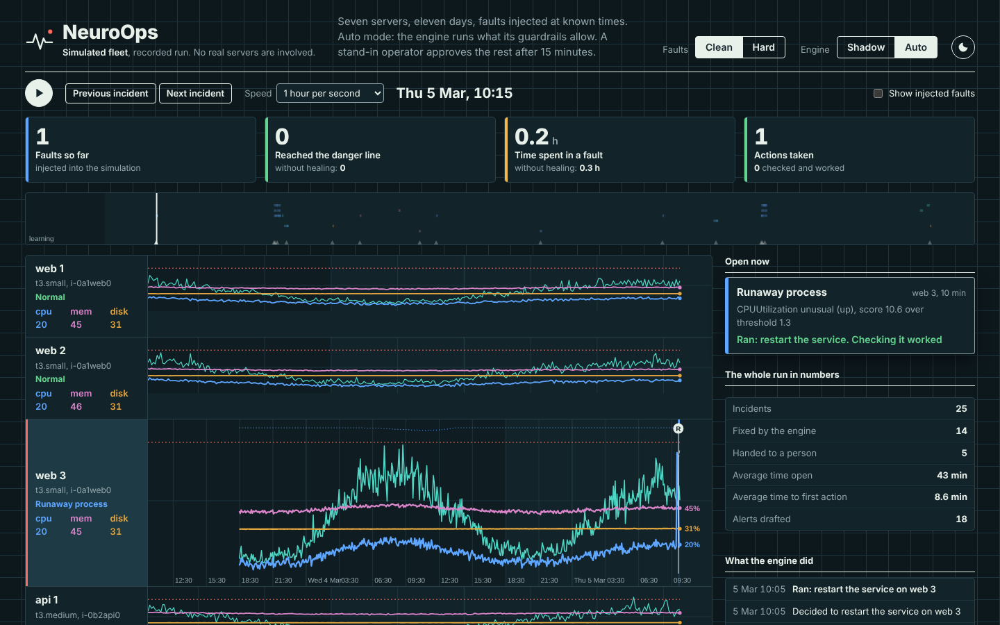
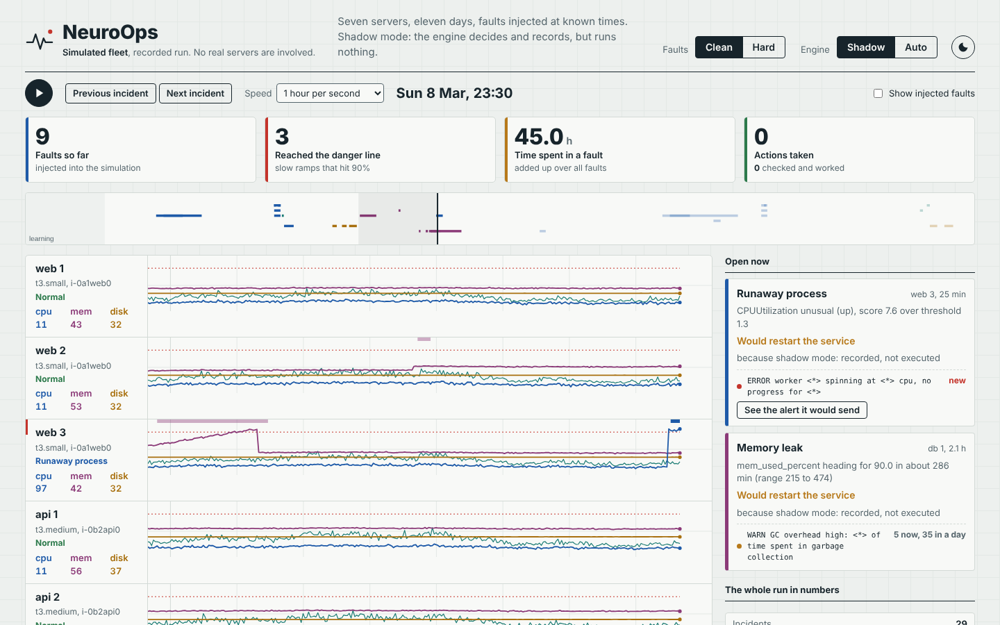

# NeuroOps

**Find it early. Fix what's safe. Tell a person the rest.**

NeuroOps is a self-healing and alerting layer for a small AWS fleet. It sits on top of CloudWatch and Terraform, it doesn't replace them. It watches your metrics and logs, works out what kind of trouble a server is in, and fixes the safe things itself: restart a service, clean a disk, add an instance. It checks that the fix worked, puts temporary changes back, and writes down every decision with the reason.

When it can't fix something, it tells you in plain words: what broke, since when, what it already tried, which log lines are new, and what to check first.

**Live demo:** https://ram15x.github.io/NeuroOps/ (recorded runs on a simulated 7-server fleet, no backend needed)



## Why it exists

Outages cost money and time, and most of that time goes to working out what is actually wrong. NeuroOps does that first part for you.

- **Earlier warning.** Disks filling and memory leaks are forecast, so you hear about them hours before they hit the limit.
- **A cause, not just an alarm.** If the whole web tier is hot it's load. If one box is hot it's a runaway process. The alert says which.
- **Fewer 3 a.m. pages.** Routine fixes run on their own, inside guardrails you set.
- **Less noise.** Thousands of log lines are grouped into a handful of kinds, and only the ones that are new or louder than usual are shown.
- **Nothing happens quietly.** Every decision, action, check and alert goes in an audit log you can read, export and turn into a postmortem.

## How it works

```
metrics + logs -> signals -> diagnosis -> policy -> executor -> verify
(CloudWatch      anomaly     the cause    guardrails  AWS or      did it
 or simulator)   forecast    of the       and mode    simulator   work?
                             trouble
                      audit log of every step, alerts to SNS or Slack
```

1. **Read.** New datapoints arrive every 5 minutes, from CloudWatch or from the simulator.
2. **Signal.** Each metric gets an anomaly score and a time-to-breach forecast. Detectors only look backwards.
3. **Diagnose.** Signals from peers are compared. The result is a cause: traffic surge, runaway process, memory leak, disk filling, CPU credit exhaustion, and so on.
4. **Decide.** The policy walks a ladder of fixes for that cause and stops at the first one the guardrails allow.
5. **Act.** The executor runs it, using the AWS API or Systems Manager. No SSH keys.
6. **Verify.** It waits, checks the signal cleared, and moves to the next rung if not. Temporary changes are undone when the trouble ends.
7. **Tell.** If a person is needed, one alert goes out per incident, with logs, evidence and a first thing to check. One more goes out when it resolves.

There are three modes. **Shadow** records what it would do and runs nothing. **Approval** waits for a person on every action. **Auto** runs what the guardrails allow and asks for the rest. It starts in shadow.



## Guardrails

Set in [config/policy.yaml](config/policy.yaml), validated at startup:

- a cooldown per target and an hourly cap on automatic actions
- protected tiers (the database is never touched automatically)
- a cap on how far it can scale out
- actions that always need a person: moving a host (downtime) and switching to unlimited credits (cost)
- it only touches instances and Auto Scaling groups tagged `neuroops:managed=true`, checked in code and by the IAM role

A bad policy file stops the app with the reason. The policy can add approval requirements but never remove the built-in ones.

## Architecture

```
dashboard (static)          plays recordings, or talks to the live API
      |
FastAPI  /api/v1/engine/*   status, fleet, incidents, audit, approvals, reports, postmortems
      |                     /metrics (Prometheus), /health, /ready, JWT login
      |
Runner / LiveRunner         one tick every 5 minutes of data
      |
Engine                      signals -> diagnose -> policy -> execute -> verify
   |        |         |
sources   executors   notifier
 sim       sim         recorder
 CloudWatch AWS        SNS, Slack
      |
storage: database (audit log, users), optional S3 archive (gzipped JSONL, encrypted)
```

| Part | Where | What it does |
|---|---|---|
| Engine | `backend/engine` | signals, diagnosis, policy, executors, alerts, reports |
| Detectors | `backend/detect` | hybrid seasonal anomaly score, Theil-Sen forecast |
| Logs | `backend/logs` | Drain-style grouping and "what is new" ranking |
| Simulator | `backend/sim` | a 7-instance fleet that reacts to the engine's actions |
| Storage | `backend/storage`, `backend/models` | audit log in the database, S3 archive |
| API | `backend/api` | FastAPI routes |
| Dashboard | `dashboard` | static page, no build step |
| Evaluation | `eval` | detector scorecard, closed-loop test, demo recordings |
| Infra | `infra/terraform` | engine instance, least-privilege role, agent config, SNS, S3 |

More detail is in [docs/architecture.md](docs/architecture.md), [docs/logs.md](docs/logs.md) and [docs/model-card.md](docs/model-card.md).

## Tech stack

- **Backend:** Python 3.13, FastAPI, SQLAlchemy, Alembic, Pydantic
- **Detection:** scikit-learn (Isolation Forest), SciPy (Theil-Sen), pandas, NumPy
- **AWS:** boto3 for EC2, Auto Scaling, CloudWatch, CloudWatch Logs, SSM, SNS and S3
- **Frontend:** plain HTML, CSS and JavaScript with canvas charts
- **Infra:** Terraform, Docker, GitHub Actions, GitHub Pages, ghcr.io
- **Observability:** Prometheus text at `/metrics`
- **Tests:** pytest, with moto (including a moto server over HTTP) standing in for AWS

## Run it

```
pip install -r requirements.txt
python -m eval.export_replay          # builds the demo recordings
uvicorn backend.main:app --reload     # API, plus the dashboard at /dashboard/
```

Or `docker compose up`. The demo needs no AWS account: it uses sqlite and an in-memory Redis. API docs are at `/docs`.

### On a real account

1. Tag the instances you want watched and managed `neuroops:managed=true`, and give each a `Role` tag (web, api, db).
2. Run the CloudWatch agent so memory and disk are reported (the Terraform config sets it up).
3. Set `ENGINE_SOURCE=cloudwatch`. It stays alert-only until you also set `ENGINE_LIVE_ACTIONS=true`.
4. Read the audit log for a few days in shadow before moving to approval or auto.

[infra/terraform](infra/terraform/README.md) creates the engine box, IAM role, SNS topic, status alarm and archive bucket. Alerts go to SNS (`ALERT_SNS_TOPIC_ARN`) or Slack (`ALERT_SLACK_WEBHOOK`).

## Build and test

```
pip install -r requirements-dev.txt
pytest                                # unit, API and live-loop tests
python -m eval.scorecard              # the detector scorecard, about 7 minutes
```

CI runs lint, tests, the scorecard, a Docker build that boots and serves the dashboard, and `terraform validate`. Pushes to `main` publish an image to ghcr.io and rebuild the demo site.

## Results

- **Real data:** on the NAB benchmark's AWS CPU series, the default detector catches 8 of 16 labelled anomaly windows at 0.21 false alarms per series-day. A static threshold catches 3.
- **Forecast:** all 18 injected slow ramps were warned about, 4 to 6 hours ahead.
- **Closed loop, clean run:** 48 of 48 faults diagnosed, and 0 of 18 ramps reached the danger line with healing on (18 of 18 without).
- **Closed loop, hard run** (noisier, overlapping faults): 35 of 54 diagnosed, 1 of 18 ramps reached the danger line.
- **Log grouping:** 0.85 mean grouping accuracy on real labelled Loghub samples.

Full tables are in [docs/scorecard.md](docs/scorecard.md) and [docs/logs.md](docs/logs.md).

## Secrets

The demo needs none. For a real deployment, create two SecureString parameters in SSM Parameter Store, `/neuroops/jwt-secret` and `/neuroops/admin-password`. The app refuses to start in production with the defaults.
